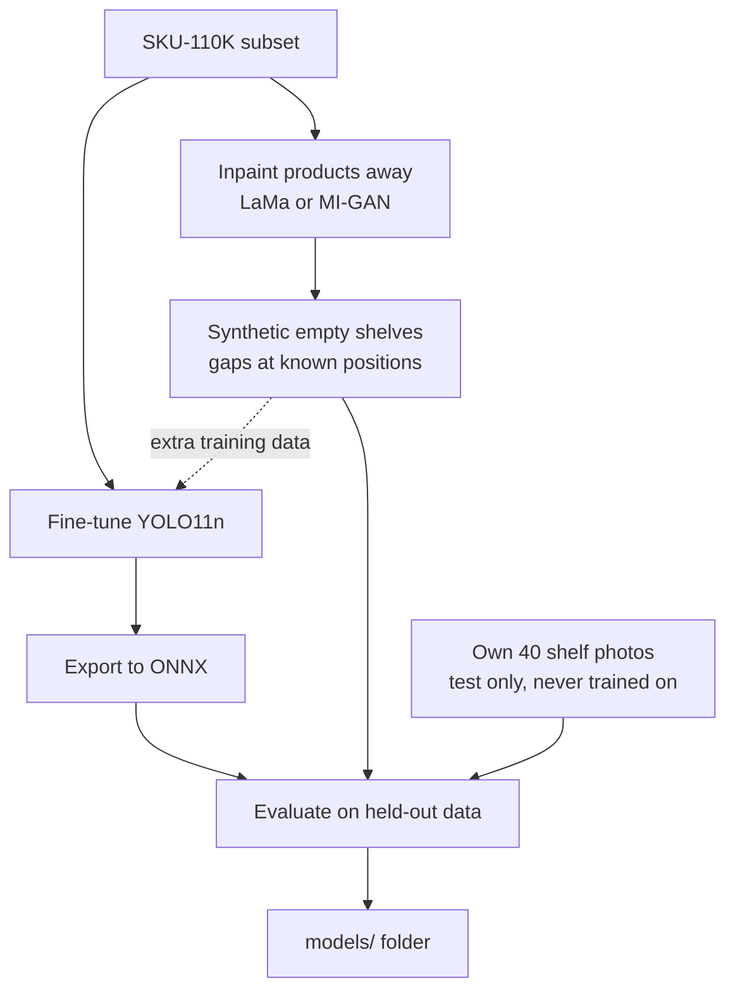
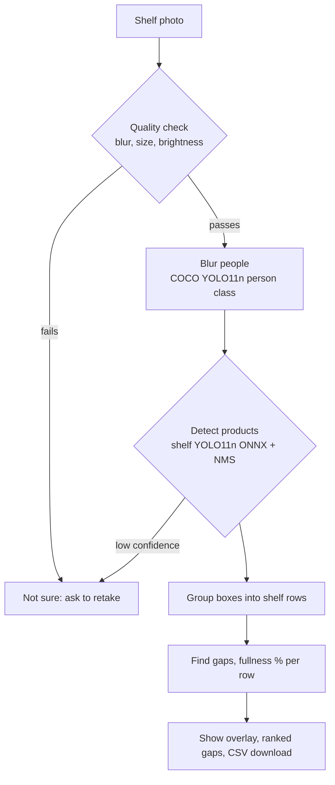

# ShelfWatch architecture

Two halves: what is built once on Colab, and what the app does for every photo.

## 1. Build (offline, on Colab)

## 2. App (every uploaded photo, on Streamlit Community Cloud)

Nothing is saved: the photo lives in memory for one request only.
